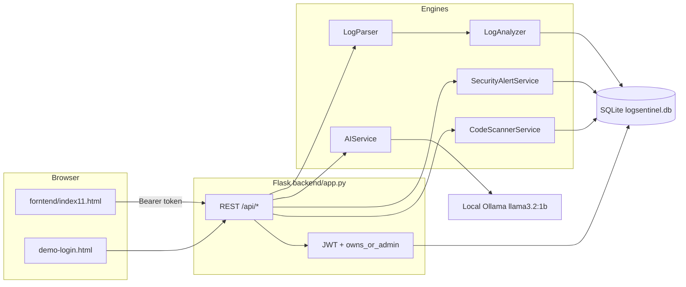
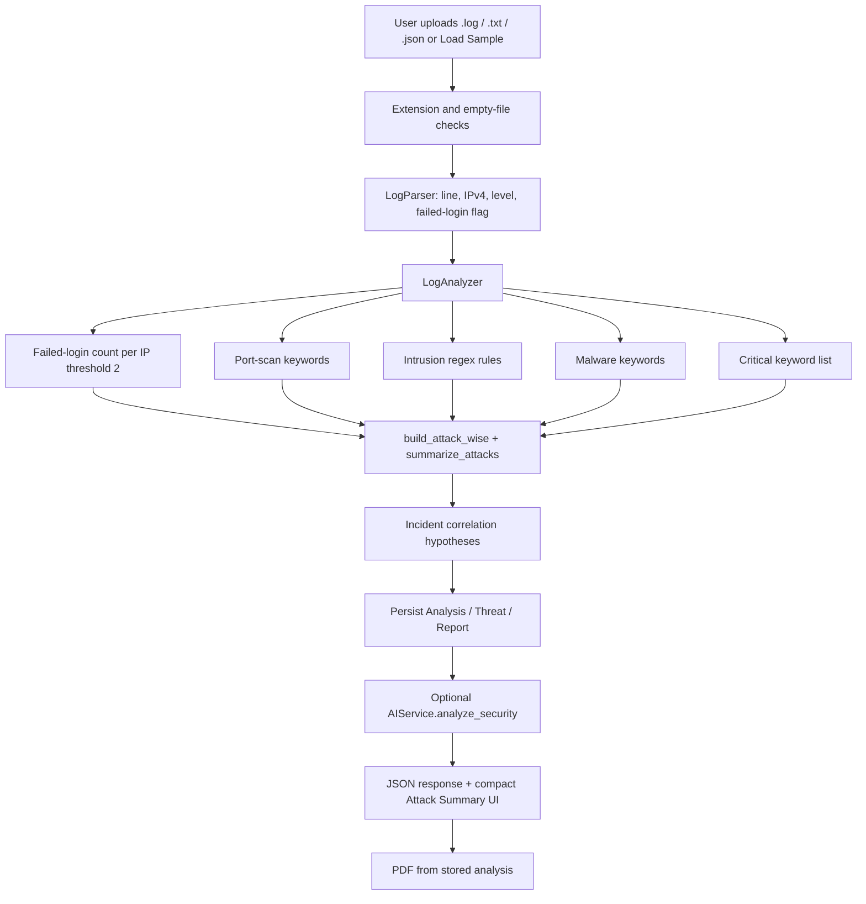
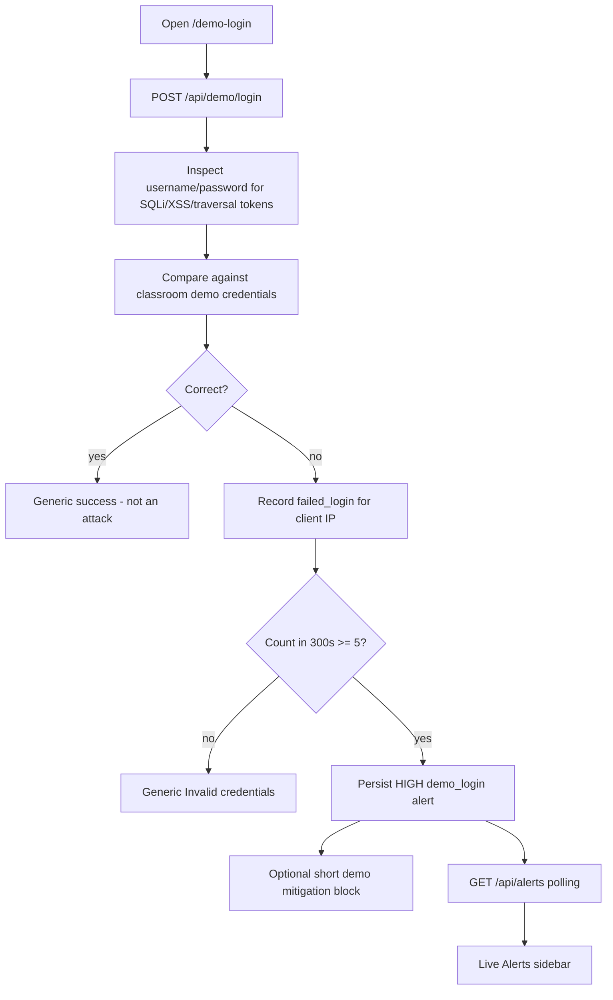
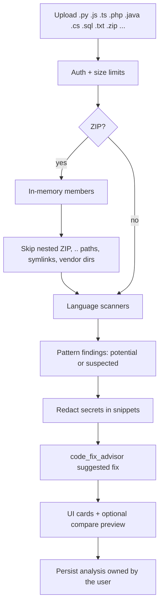
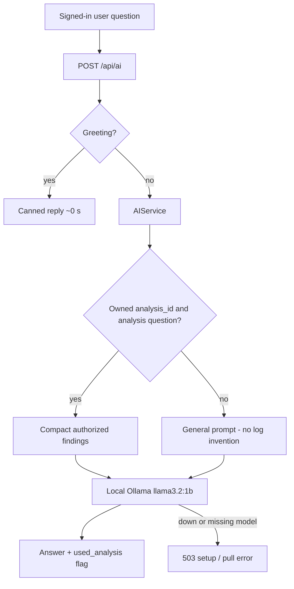

# LogSentinel — Project Documentation

**Title:** LogSentinel — Local Log Intelligence, Alert Demonstration, and Source-Code Review Prototype  
**Type:** BCA Cyber Security college project / classroom prototype  
**Primary sources:** the repository, `LOGSENTINEL_FULL_AUDIT_REPORT.md` (12 October 2026), `LOGSENTINEL_LARGE_CODEBASE_AUDIT.md`, `COLLEGE_EVALUATOR_NOTES.md`, `OLLAMA.md`, and `backend/config.py`  
**Frontend directory:** `forntend/` (this spelling is the actual folder name)  
**Branding:** LOGSENTINEL (LOG + SENTINEL)

This document describes the **implemented** system. It is not a production Security Operations Center, not a network IDS/IPS appliance, and not a claim of comprehensive real-world detection.

---

## 1. Abstract

LogSentinel is a local web application that helps a signed-in user review uploaded security logs, inspect compact Attack Summary counts, download a PDF report, demonstrate threshold-based login alerts, scan source files for pattern-based vulnerabilities, and ask a small local language model about general topics or owned analysis results.

The detection engine is rule-based (regular expressions, keywords, and a failed-login counter). SentinelAI uses local Ollama (`llama3.2:1b` by default) and does not fall back to a paid cloud API on the intended path. Ownership checks keep one user’s reports, incidents, and analyses private from another user.

## 2. Problem statement

Students and small teams often have log files and source code, but not a heavy SIEM or a commercial SAST license. They need a **transparent, offline-capable prototype** that can:

1. Parse uploaded logs and show *why* a line matched a rule, using the original evidence.
2. Group findings into a compact Attack Summary with attempt counts and source IPs.
3. Demonstrate a login-alert threshold without treating production sign-in as an attack feed.
4. Scan uploaded source or a ZIP project for common insecure patterns and show a suggested fix preview.
5. Answer questions locally, without sending log excerpts to a cloud model.

Existing commercial tools solve parts of this, but they are not designed as an inspectable college prototype with honest limits.

## 3. Motivation

- Make log analysis **explainable**: each finding keeps the original line; URL decoding is used only for matching.
- Separate **log detection**, **demo-login alerts**, and **source-code scanning** so a classroom demo does not pretend the app is watching a live network.
- Keep inference **on the laptop** after one `ollama pull`.
- Practise authentication, authorization, upload safety, and test integrity that a cyber-security student should be able to defend in a viva.

## 4. Objectives and scope

### Implemented objectives

| Objective | Where it lives | Status |
|-----------|----------------|--------|
| Register / login with JWT | `backend/routes/auth.py` | Implemented and tested |
| Parse uploaded `.log` / `.txt` / `.json` | `LogParser` | Implemented (no dedicated `timestamp` column) |
| Detect documented attack categories | `LogAnalyzer` | Implemented within rule limits |
| Compact Attack Summary + PDF | `attack_wise.py`, `report_service.py` | Implemented |
| Isolated demo-login Live Alerts | `demo_auth.py`, `security_alerts.py` | Implemented (threshold 5 / 300 s) |
| Incident correlation hypotheses | `incident_correlation.py` | Implemented (same IP, 900 s window) |
| Pattern-based source-code scan + fix preview | scanners + `code_fix_advisor.py` | Implemented; suggestions are not verified patches |
| Local SentinelAI | `ai_service.py`, `ollama_client.py` | Implemented for local Ollama |
| Owner-or-admin access to reports / incidents / AI analysis context | `owns_or_admin` | Implemented and live-verified |
| Production refusal of the known JWT placeholder | `runtime_secrets.py` | Implemented |
| Offline detection evaluation on a labeled synthetic set | `backend/evaluation/` | Implemented; synthetic metrics only |

### Partially implemented

| Item | What works | What does not |
|------|------------|---------------|
| Malware vs intrusion titles | Keyword malware rules exist | Same-evidence malware aliases collapse to the intrusion title (PARTIAL in the audit) |
| Encoded payloads | XSS, traversal, SQLi, `; whoami` / `\| whoami` after bounded `unquote_plus` | Evasions such as `${IFS}whoami` are unsupported |
| Critical events | Keywords such as `kernel panic`, `segfault` | The word CRITICAL alone is **not** a detector |
| Code scanning languages | Python, JS/TS, PHP, HTML/CSS, `.txt`, Java, C#, SQL, some config / dependency hints | No Go/Rust/Ruby/Docker engines; no CVE feed; no taint analysis |
| SentinelAI analysis attachment | Owned `analysis_id` can be attached | Small 1B model; latency varies; does not create new detections |
| Mobile layout | Usable; `overflow-x` left visible | Exact 390×844 `innerWidth` was **not** achieved in the embedded browser host |
| OpenAI provider | Code path exists if `AI_PROVIDER=openai` | **Not** the college demo path; no key is required for default chat |

### Not implemented / out of scope

- Network-wide packet capture or continuous host monitoring
- Automatic blocking of real attackers on production `/api/login`
- Cloud AI fallback when Ollama is down
- “Confirmed compromise” verdicts (incident groups are hypotheses)
- Production-ready multi-worker job queue for large scans
- Comprehensive real-world detection or 100% precision/recall

---

## 5. System architecture and technology stack

### Technology stack (from the repository)

| Layer | Technology |
|-------|------------|
| UI | Single-page HTML/CSS/JS in `forntend/index11.html`; isolated `forntend/demo-login.html` |
| API | Flask 3, Flask-CORS, Flask-Limiter, Flask-SQLAlchemy |
| Auth | bcrypt password hashes, PyJWT HS256, `Authorization: Bearer` |
| Data | SQLite `backend/logsentinel.db` by default; `DATABASE_URL` can point elsewhere |
| Detection | pandas DataFrame + compiled regex rules |
| PDF | ReportLab |
| Code scan | In-process pattern scanners; ZIP members opened in memory |
| Assistant | Local Ollama HTTP API, default model `llama3.2:1b` |
| Tests | unittest modules (run **separately**) plus a custom `test_auth.py` runner |

### Overall architecture



The app does **not** sit on a network tap. It processes files the user uploads and events created by the isolated demo-login page.

---

## 6. Frontend, backend, database, and Ollama

### Frontend

- Served from `forntend/` by Flask.
- Dark theme by default; Light Mode toggle (`ls_theme`) is implemented.
- Sections: Dashboard, Log Analyzer, compact Attack Summary, Live Alerts, Incident Investigation, Vulnerability Scanner, SentinelAI chat, PDF download.
- Sample button loads **synthetic** `SAMPLE_LOG` (labeled demonstration data), not a live incident.

### Flask backend

`create_app()` in `backend/app.py` registers blueprints, applies rate limits, creates tables, and calls `assert_secure_secrets()`. Default `python app.py` binds **127.0.0.1:5000** with debug off unless `FLASK_RUN_HOST` / `FLASK_DEBUG` are set.

### Database models (implemented)

`users`, `uploaded_files`, `analyses`, `threats`, `reports`, plus security-alert tables maintained by `ensure_user_schema()`. Analyses created before auth (`user_id` NULL) are admin-only.

### Local Ollama

- Default: `AI_PROVIDER=ollama`, `http://127.0.0.1:11434`, model `llama3.2:1b`.
- Greetings such as “Hey” are short-circuited and do not call the model.
- If Ollama is down or the model is missing, chat returns a setup error (503 in mocked tests). There is **no** cloud fallback on the intended path.
- **Ollama defaults when env is unset** (source: `backend/utils/ollama_settings.py`, used by `AIService`): timeout **60** s, `num_ctx` **1024**, `num_predict` **80**, `keep_alive` **60m**. `_request_options` then caps context to 768 (general) or 1024 (analysis). `.env.example` and `OLLAMA.md` now match those numbers. A local `backend/.env` may still set `OLLAMA_TIMEOUT_SECONDS=90`; that is an override, not the code default.

---

## 7. Log parsing and attack detection workflow



### Parser (`LogParser`)

Each line becomes a row with `message` (the original line), a coarse `level`, first IPv4 if present, and `is_failed_login` when the line contains `failed password` or `failed login`. There is **no** `timestamp` column. ISO prefixes may later be recovered by Attack Summary; many Threat rows have empty timestamps.

### Analyzer (`LogAnalyzer`)

- **Brute Force:** count failed logins per IP; flag when count ≥ **2**. Evidence is the first failed-login row for that IP.
- **Port Scan:** keywords such as `port scan`, `portscan`, `nmap`, `masscan`.
- **Intrusion rules (independent; one line can match several):** SQL Injection, XSS, Directory Traversal, Command Injection, Suspicious PowerShell, Reverse Shell, Web Shell, Privilege Escalation / Unauthorized Access.
- **Detection-only decode:** bounded `unquote_plus` (max 2 passes, 8000-character cap). PDF/evidence keep the raw line.
- **Command Injection (current rules):** includes `shell_exec`, `\bsystem(`, `; cat`, `/bin/sh`, `[;&|]` + `whoami|id|uname`, backticks, and `$(whoami)`.
- **Critical System Event:** keyword list only (`kernel panic`, `oom kill`, `out of memory`, `segfault`, `disk full`, `hardware error`, `fatal error`, `system crash`).
- **Malware:** word-boundary / keyword rules. If the same evidence already matched an intrusion rule, the malware alias is not double-counted.

These are **intentionally different detectors**:

| Detector | Setting | Default | What it counts |
|----------|---------|---------|----------------|
| Uploaded-log Brute Force | `BRUTE_FORCE_THRESHOLD` (`log_brute_force_threshold()`) | **2** failed logins per IP | Historical lines in a file |
| Live Alerts | `ALERT_FAILED_LOGIN_THRESHOLD` + `ALERT_FAILED_LOGIN_WINDOW_SECONDS` | **5** failures in **300** s | Isolated `/demo-login` only |

`Config.BRUTE_FORCE_THRESHOLD` now defaults to **2** and the analyzer reads `BRUTE_FORCE_THRESHOLD` at call time. It does **not** drive Live Alerts. Raising the log threshold does not change the demo-login 4-vs-5 proof.

---

## 8. Compact Attack Summary and PDF reporting

Attack Summary is one row per **named attack type**, with attempt counts and `source_ip_display` (or **Not available**). It does not invent IPs.

The sample demonstration log (`samples/multi_attack_demo.log` / UI `SAMPLE_LOG`) is expected to produce **7** named types: Brute Force, Port Scan, Directory Traversal, SQL Injection, XSS, Web Shell, Privilege Escalation.

PDF generation (`GET /api/report/<id>/pdf`) is owner-or-admin. Live check: owner **200** `application/pdf` starting `%PDF-1.4`; other user **403**. Empty IPs render as Not available. Page-by-page glyph layout in an external viewer was **not** exhaustively measured.

---

## 9. Live Alerts and demo-login workflow



Important classroom facts:

- Production `/api/login` wrong passwords are **not** Live Alerts.
- Uploaded-log analysis does **not** create Live Alerts.
- Demo-login alerts have no owner and are **visible to every signed-in user** (shared classroom events).
- Private (owned) alerts stay hidden from other users.
- Threshold proof is the isolated suite on a temp DB and a clean IP (`203.0.113.201`). A live 4-then-5 on `127.0.0.1` can be inconclusive if that address already has events in the 300-second window. **Do not wipe `logsentinel.db` to make the demo look cleaner.**

---

## 10. Incident correlation and investigation

`correlate_incidents()` groups already-detected findings. It does not run new detection.

- Same source IP inside `INCIDENT_CORRELATION_WINDOW_SECONDS` (default **900**) can form a **possible correlation**.
- Unrelated events that only share a timestamp are **not** correlated.
- The API states that groupings are hypotheses; a rule match is not proven compromise.
- List and detail endpoints require the analysis owner (or admin). Other user → **403**.

On `samples/multi_attack_demo.log`, an audited run reported 7 confirmed findings, 1 possible correlation on `10.0.0.99`, and 4 total incidents. Treat those numbers as that run’s output, not a universal constant.

---

## 11. Source-code scanner and Vulnerability Fix Preview



This is **pattern-based SAST**. It does not execute uploaded code, does not prove an app is secure, and does not look up CVEs.

- Log uploads: default **10 MB** (`MAX_UPLOAD_MB`).
- Code-scan uploads: separate `CODE_SCAN_*` limits (50 MB upload, 1 MB per file, 1500 ZIP members, 80 MB extract, 90 s, compression-ratio guard).
- `.txt` can be treated as source or as security logs (user choice in the UI).
- Suggested Fix and Copy Fixed Code show a **minimal example**. A compare endpoint can show that a snippet no longer matches; that does **not** mean the whole program is safe.
- Background scan jobs are **in-process** (lost on Flask restart; not multi-worker safe).

---

## 12. Local SentinelAI and limitations



Verified behaviour:

- Default provider is local Ollama. Intended chat path does not call a cloud API.
- Greetings do not attach analysis.
- Another user cannot put someone else’s analysis into the prompt (**403** / ignored).
- Live latencies **vary**. Examples recorded in the audit: greeting ~0 s; a short general question about 0.7–9 s; analysis questions about 19–24 s on `llama3.2:1b`. Do not quote a single “average response time” as a product guarantee.
- `llama3.2:1b` is a small model chosen for roughly 8 GB RAM laptops. It can be vague or wrong. Detector output remains the source of truth.

---

## 13. Authentication, authorization, uploads, and rate limits

| Control | Implementation |
|---------|----------------|
| Registration | Username, email, password rules; client `role=admin` is ignored; `ADMIN_EMAILS` can grant admin |
| Passwords | bcrypt hashes; plaintext is not stored or returned |
| JWT | HS256; expiry default 24 h; invalid / expired / missing → **401** |
| Ownership | `owns_or_admin` on reports, charts, incidents, code reports, AI analysis context |
| Production secrets | If env is `production`/`prod`, missing, placeholder `change-me-in-production`, or secret shorter than 16 characters → **refuse to start** |
| Local demo secrets | Without those production flags, a warning is printed and the placeholder may still be used |
| Log upload | `.log` / `.txt` / `.json`; empty file rejected; `.exe` rejected |
| ZIP scan | Path traversal, nested ZIP, symlink, bomb-ratio, size/count limits skipped with warnings |
| Rate limits | `AUTH_RATE_LIMIT` default 10/minute; `RATE_LIMIT` 60/minute; demo 30/minute. Configured; **not soak-tested** |
| Demo vs production login | Separate blueprints |

---

## 14. Installation and local run (Windows)

Do not commit a real `.env`. Do not paste JWT values into reports.

```powershell
cd "C:\Users\abhay\OneDrive\Desktop\LOGSENTINEL AUTH\backend"
python -m venv venv
.\venv\Scripts\activate
pip install -r requirements.txt
```

From the project root and/or `backend/`, copy `.env.example` to `.env` and set a long random `SECRET_KEY` / `JWT_SECRET` for anything beyond a private classroom demo. `config.py` loads the **project-root** `.env` first, then `backend/.env` with `override=True` (backend wins). Empty `JWT_SECRET` / `DATABASE_URL` / selected Ollama and OpenAI keys are then popped so code defaults apply.

```powershell
ollama pull llama3.2:1b
ollama list
```

```powershell
cd backend
python app.py
```

Open `http://127.0.0.1:5000/`. Register or sign in. Keep Ollama listening on `127.0.0.1:11434` for chat.

Detection, Attack Summary, PDF, Live Alerts, incidents, and code scanning work **without** the model. Chat does not.

---

## 15. Testing methodology and actual results

Suites **must** be run in separate processes. Importing several modules in one `unittest` process overwrites `JWT_SECRET` (known isolation issue; not silently “fixed” by combining them).

Results below were recorded on 12 October 2026 in `LOGSENTINEL_FULL_AUDIT_REPORT.md` unless noted. Do not treat unexecuted suites as passing.

| Suite | Recorded result | Exit |
|-------|-----------------|------|
| `test_runtime_secrets` | 5 OK | 0 |
| `test_detection_eval` | 7 OK | 0 |
| `test_attack_wise` | 23 OK | 0 |
| `test_security_alerts` | 24 OK | 0 |
| `test_incident_correlation` | 12 OK | 0 |
| `test_ai` | 53 OK | 0 |
| `test_code_scan` | 31 OK | 0 |
| `test_large_codebase_scan` | 13 OK | 0 |
| `test_check_runner` | 8 OK; failing fixture process exit 1 | 0 |
| `test_auth.py` | 71 PASS / 0 FAIL / 0 ERROR / 0 SKIP | 0 |

`test_ai` is mostly mocked. `test_real_ollama_latency_when_available` calls local Ollama when it is reachable (audit example: `2+2` in 0.682 s). `OLLAMA.md` now states that.

### Synthetic detection metrics (not real-world accuracy)

`backend/evaluation/synthetic_dataset.jsonl` scored by `LogAnalyzer` (overlap = one score per original line + attack title; brute force is one group per IP; unsupported labels excluded):

| Metric | Value on that set |
|--------|-------------------|
| True Positives | 20 |
| False Positives | 0 |
| True Negatives | 5 |
| False Negatives | 0 |
| Precision / Recall / F1 | 1.0 / 1.0 / 1.0 |
| False Positive Rate | 0.0 |

These numbers are **only** for that labeled synthetic file. They are not a guarantee for production logs.

Unsupported on that set (not counted as successful detections): `${IFS}whoami`, CRITICAL level without a keyword, SQL `WAITFOR DELAY`.

---

## 16. Known limitations

1. Keyword/regex detection; evasions and novel attacks are missed.
2. `${IFS}whoami`, `WAITFOR DELAY` SQLi, CRITICAL-as-level-word are documented misses.
3. Malware alias collapse on shared evidence (PARTIAL).
4. Parser has no timestamp column.
5. Analyzer brute-force threshold (default 2, env `BRUTE_FORCE_THRESHOLD`) is intentionally different from Live Alerts (5 / 300 s).
6. Live demo 4-vs-5 on a reused classroom IP can be polluted.
7. Analyze latency includes optional local AI summarization after detection.
8. `llama3.2:1b` quality and latency are limited.
9. Code scanner is not taint analysis and has no CVE database.
10. Scan jobs are in-process only.
11. Flask-Limiter default storage is in-memory (not multi-worker).
12. Rate limits were not soak-tested.
13. Embedded-browser 390 CSS viewport was not achieved (414×896 observed).
14. Combined unittest process is unsafe because of JWT config import time.

---

## 17. Future improvements (not implemented)

These are reasonable next steps, **not** present features:

- Timestamp-aware parsing and richer log formats (JSON syslog, Windows Event).
- Tunable analyzer threshold from configuration (one source of truth).
- Broader, still-tested injection/evasion rules.
- Persistent scan-job queue if more than one Flask worker is required.
- Broader SAST languages or an optional local vulnerability database (still without claiming completeness).
- Stronger test isolation so suites can share one process only after that isolation is fixed and tested.

---

## 18. Conclusion

LogSentinel is a **credible classroom prototype**: upload → parse → detect → summarize → PDF, plus isolated demo alerts, incident hypotheses, pattern SAST with a fix preview, and a local 1B-parameter assistant.

It is suitable for a college demonstration and viva if the student explains what is implemented, what is synthetic, and what is unsupported. It is **not** production-ready security monitoring and does **not** claim comprehensive detection or successful remediation of real applications.
